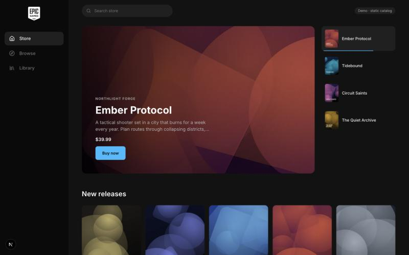

# Epic Games Store clone

A game storefront built with **Next.js 16**, **Drizzle ORM** and **SQLite**: featured carousel, filtered browsing, game pages with media galleries, a personal library, optional **Clerk** sign-in and **Stripe** checkout. Every external service is optional, so the store always deploys. With nothing configured, it runs as a read-only demo backed by a static catalog.

> A portfolio project, not affiliated with Epic Games. The games and all artwork are fictional and generated in code.



## Features

- **Featured carousel** that rotates until you interact with it, pauses on hover and focus, and respects reduced-motion settings.
- **Browse and search** by title or developer, genre, platform and price, with sorting and pagination. Filters are a plain GET form, so they work before JavaScript loads and every result page has a shareable URL.
- **Game pages** with a screenshot gallery (keyboard navigable), details and similar games ranked by shared genres.
- **Library and checkout**: free games are claimed directly. Paid games go through Stripe Checkout, and a verified webhook adds them to your library.
- **Generated artwork**: covers, banners and screenshots are drawn with `next/og` from each game's palette and prerendered at build time. No third-party images.

## Architecture

```
src/
  data/catalog.ts         the catalog: seeds SQLite and powers the static fallback
  db/                     Drizzle schema (SQLite), client, seed
  lib/store/              Store interface + two implementations
    db-store.ts           SQLite through Drizzle
    static-store.ts       in-memory catalog (read-only)
    index.ts              picks one: database if reachable, else static
  lib/actions/purchase.ts Server Action: claim or start checkout
  lib/payments.ts         webhook fulfilment (idempotent)
  app/media/[slug]/[kind] generated artwork (route handler + ImageResponse)
  proxy.ts                runs Clerk only when it is configured
drizzle/                  SQL migrations
```

**One interface, two stores.** Pages talk to a `Store` interface. `getStore()` returns the Drizzle/SQLite store when `DATABASE_URL` is set and answering. Otherwise it returns a static store built from the same catalog. A failed check is cached for 30 seconds, so a down database costs one attempt rather than one per request. A contract test suite runs against both stores, and a parity test requires identical results, so the fallback can't drift from the database.

**Optional services.** `src/config/env.ts` turns features on from environment variables. Without Clerk keys the proxy skips Clerk, and the UI shows guest mode instead of crashing; the 2023 deployment returned 500 on every page once its keys stopped working. Without Stripe, paid games are granted without payment, so the whole flow can be tried locally.

**Payments done safely.**
- The price always comes from the database. The 2023 version trusted a Stripe price id sent by the browser.
- The webhook verifies Stripe's signature and checks the paid amount against the game price.
- Fulfilment uses the `(user, game)` primary key with `ON CONFLICT DO NOTHING`, so Stripe retrying a webhook never grants a game twice.

**Data model.**
- Money is stored as integer cents.
- Genres and platforms are many-to-many through join tables.
- Filters query through those join tables with `EXISTS`. The old code joined `games.id` to `categories.id`, which matched unrelated rows.
- Search escapes `LIKE` wildcards, so `%` is a literal.
- Users live in Clerk, so the library stores the Clerk user id and there's no user table to sync.

## Getting started

```bash
npm install
cp .env.example .env    # everything in it is optional
```

Run it as a read-only demo (no database):

```bash
npm run dev
```

Or with SQLite (one file, no server):

```bash
DATABASE_URL=file:local.db npm run db:setup   # migrate + seed
npm run dev
```

To enable accounts and purchases, add Clerk keys and a Stripe **test-mode** secret key to `.env`. Then forward webhooks locally:

```bash
stripe listen --forward-to localhost:3000/api/webhooks/stripe
```

For a hosted database, point `DATABASE_URL` at Turso (`libsql://…`) and set `DATABASE_AUTH_TOKEN`.

## Scripts

| Script | What it does |
|---|---|
| `npm run dev` / `build` / `start` | Next.js |
| `npm run lint` / `typecheck` | ESLint, `tsc --noEmit` |
| `npm test` | Vitest: store contract and parity tests, payment fulfilment, utilities |
| `npm run db:generate` | Generate a migration from `src/db/schema.ts` |
| `npm run db:setup` | Apply migrations and seed the catalog |
| `npm run db:studio` | Drizzle Studio |

## Stack

Next.js 16 (App Router, Cache Components, Server Actions) · React 19 · TypeScript · Tailwind CSS 4 · Drizzle ORM · SQLite / libSQL · Clerk · Stripe · Radix UI · Zod · Vitest
